# ❤️ Cardiac Analyst v2.0

> **Academic Research & Educational Prototype for Cardiac Risk Stratification, 12-Lead ECG Analysis, and Emergency Triage**  
> *A responsive Progressive Web App (PWA) running locally in any browser with deterministic machine learning, explainable risk modeling, and zero generative AI in the diagnostic pathway.*

[](https://react.dev)
[](https://www.typescriptlang.org)
[](https://fastapi.tiangolo.com)
[](https://onnxruntime.ai)
[](https://physionet.org/content/ptb-xl/)
[](https://web.dev/progressive-web-apps)
[](LICENSE)

---

> ⚠️ **Regulatory & Medical Notice**:  
> **Cardiac Analyst is an academic research and educational prototype.** It is **not** a certified medical device (CE/FDA/CDSCO) and is **not** intended for independent clinical diagnosis, emergency dispatch, or acute patient management. In any emergency situation or suspected heart attack, immediately call **112** (India), **911** (US), or your local emergency services.

---

## 🫀 Overview

Cardiovascular disease (CVD) is the leading cause of mortality globally and claims over **4.77 million lives annually in India alone**. Over 60% of critical myocardial infarction (MI) fatalities occur before patients reach an emergency department, primarily driven by delayed symptom recognition, inaccessible diagnostic clinics, and a lack of early self-screening tools.

**Cardiac Analyst v2.0** bridges this gap as a lightweight, browser-accessible digital clinical workstation that provides three continuous stages of cardiovascular protection:

1. **Routine Screening Mode** — Daily vitals tracking (blood pressure, heart rate, blood glucose, cholesterol) with an ASCVD-calibrated LightGBM risk model and TreeSHAP explainability bars.
2. **ECG Analysis Mode** — Digital 12-lead ECG signal ingestion (CSV, NPY, JSON, WFDB), physiological interval measurement extraction (HR, rhythm, PR, QRS, QTc via Bazett's formula, ST-elevation leads), and multi-label classification across the 5 AHA/ACC diagnostic superclasses using a 1D Residual CNN running on **ONNX Runtime** (33 MB, sub-3ms CPU latency).
3. **Emergency Triage Mode** — Rapid 8-question clinical symptom triage conforming to the UK NICE CG95 guidelines, immediate 112/108 SOS emergency calling, live geolocation sharing, and interactive hospital routing filtered by ICU and cardiac catheterization lab capabilities.

---

## 🛡️ Core Clinical Principles: Zero GenAI in Diagnostics

In healthcare software, probabilistic hallucination can be catastrophic. Cardiac Analyst enforces a strict architectural boundary:

```
┌────────────────────────────────────────────────────────────────────────┐
│                      DIAGNOSTIC PATHWAY (100% DETERMINISTIC)           │
│                                                                        │
│   Digital ECG ──► SciPy Waveform Signal Processing ──► Heart Rate, QTc │
│   Signal (12L) ──► 1D ResNet (ONNX Runtime CPU) ──► 5 Superclass Scores│
│   Daily Vitals ──► Calibrated LightGBM + TreeSHAP ──► 10-Yr Risk Score │
│   Symptoms ────► NICE CG95 Clinical Decision Rules ──► Triage Urgency  │
└────────────────────────────────────────────────────────────────────────┘
                                     │
                                     ▼
┌────────────────────────────────────────────────────────────────────────┐
│             DUAL-PERSPECTIVE CLINICAL & FAMILY EXPLANATION             │
│                                                                        │
│   Deterministic Dual Analysis Report (Zero LLM Hallucination):         │
│   • Clinical Specialist View: ICD-10 codes, electrophysiology & rhythm │
│   • Family Plain-Language Guide: Everyday analogies, checklist & Qs    │
└────────────────────────────────────────────────────────────────────────┘
```

- **Zero Generative AI for Diagnosis**: Diagnostic labels, confidence scores, heart rates, intervals, and emergency triage urgency levels are computed **exclusively** by deterministic algorithms, validated machine learning models, and clinical rule engines.
- **Explicit Failure Handling (Rule 7)**: Low-amplitude noise, sensor saturation (>100 mV), flatlines ($\text{var} < 10^{-6}$), or malformed inputs return `status: "analysis_unavailable"` with actionable guidance, completely eliminating fabricated medical outputs.
- **Calibrated Uncertainty Bounds**: Predictions within $\pm 0.05$ of locked clinical thresholds are flagged with `uncertainty_flag: true` to alert clinicians to borderline readings.

---

## 🚀 Key Features

### 1. Routine Screening Mode
- **Daily Vitals Logger**: Structured entry for systolic/diastolic blood pressure, resting heart rate, SpO2, blood glucose, total cholesterol, HDL, and smoking/diabetes history.
- **10-Year ASCVD Risk Score**: LightGBM ensemble trained on clinical cohorts and calibrated using Platt scaling to output risk tiers: *Low Risk* (<10%), *Borderline* (10–20%), and *Elevated* (>20%).
- **Interactive TreeSHAP Explainability**: Visual horizontal feature attribution bars revealing exact percentage contributions (e.g., *"Systolic BP contributed +34% to risk"*).
- **Longitudinal Trend Tracking**: 30-day interactive time-series charts displaying systolic/diastolic BP, heart rate, and historical risk progression.

### 2. Digital 12-Lead ECG Analysis Mode
- **Multi-Format Signal Ingestion**: Supports standard digital 12-lead ECG formats: CSV, JSON, NumPy arrays (`.npy`), and WFDB records (1,000 samples @ 100 Hz, 10 seconds).
- **Deterministic Interval & Rhythm Extraction**:
  - Heart rate calculation via SciPy peak detection.
  - Rhythm classification: Normal Sinus Rhythm, Sinus Tachycardia (>100 bpm), Sinus Bradycardia (<60 bpm), or Irregular Rhythm.
  - PR interval, QRS complex duration, and Bazett-corrected QTc calculation ($\text{QTc} = \frac{\text{QT}}{\sqrt{\text{RR}}}$).
  - Real-time ST-segment deviation detection across anterior, inferior, and lateral lead groupings.
- **5 Diagnostic Superclass Classification (PTB-XL Standard)**:
  - `NORM`: Normal Sinus ECG
  - `MI`: Myocardial Infarction (Acute Heart Attack / Ischemic Necrosis)
  - `STTC`: ST/T-Wave Changes (Subendocardial Ischemia / Repolarization Abnormality)
  - `CD`: Conduction Disturbance (Bundle Branch Blocks, Hemiblocks, AV Blocks)
  - `HYP`: Ventricular & Atrial Hypertrophy (LVH / RVH)
- **Built-In PTB-XL Benchmark Demos**: One-click demo triggers for held-out Fold 10 records across all 5 classes, plus edge-case tests (flatline, noisy sensor).
- **Interactive 12-Lead Oscilloscope**: Real-time multi-lead canvas renderer and Web Audio API cardiac sound synthesizer.

### 3. Emergency Triage Mode
- **NICE CG95-Aligned Assessment**: Rapid 8-question clinical symptom questionnaire evaluating crushing retrosternal chest pain, radiation to jaw/left arm, diaphoresis, dyspnea, syncope, and known coronary history.
- **Severity Stratification**: Categorized into `EMERGENCY` (Red), `URGENT / SEE DOCTOR TODAY` (Amber), or `ROUTINE MONITORING` (Green).
- **One-Tap SOS Dialer**: Immediate direct emergency calling links (`tel:112` and `tel:108`).
- **Live Hospital Finder**: Interactive Leaflet/OpenStreetMap interface querying nearby emergency departments and cath-lab centers within 5–50 km with direct turn-by-turn navigation routes.

### 4. Patient Empowerment & Accessibility
- **Bilingual Interface**: Native English and Hindi (`हिन्दी`) support for all UI controls, clinical descriptions, and patient guidance.
- **Dual-Perspective Reporting**: One-click toggle between rigorous electrophysiological reports (for physicians) and plain-language summaries with everyday analogies and family checklists (for non-physicians).
- **PWA Ready**: Offline-capable service worker for emergency hospital lists and first-aid instructions even during network disruptions.

---

## 🏗️ System Architecture

```mermaid
graph TD
    subgraph Frontend ["Frontend Workstation (React 19 + TypeScript + Vite + Tailwind CSS)"]
        UI[AppShell: Collapsible Rail + TopBar]
        OverviewView[OverviewMode: Dashboard & Status]
        RoutineView[RoutineMode: Vitals & SHAP]
        ECGView[ECGMode: 12-Lead Digital Ingestion]
        ECGViewer[ECGViewer: Authentic Medical Grid Canvas]
        DualReport[DualAnalysisReport: Clinical vs Family]
        HistoryView[HistoryMode: Medical Ledger]
        EmergencyView[EmergencyMode: NICE CG95 Triage]
        MapComp[HospitalMap: Leaflet + OpenStreetMap]
        ZustandStore[(Zustand Global State)]
    end

    subgraph ReverseProxy ["Reverse Proxy (Vite Dev / Nginx)"]
        Proxy["/api/* -> http://localhost:8000"]
    end

    subgraph Backend ["FastAPI Modular Backend (Python 3.11)"]
        MainApp[main.py: App Factory & CORS Middleware]
        VR[Vitals Router: /api/v1/vitals]
        ER[ECG Router: /api/v1/ecg]
        EmR[Emergency Router: /api/v1/emergency]
        HR[Hospitals Router: /api/v1/hospitals]
        HealthR[Health Check: /health]
    end

    subgraph MLLayer ["Machine Learning & Inference Services"]
        ECGService["ECGInferenceService (ONNX Runtime CPU)"]
        ONNXModel["backend/models/model.onnx (33.37 MB)"]
        Thresholds["thresholds.json (Locked Val Thresholds)"]
        RiskService["RiskModel (LightGBM + TreeSHAP)"]
        RiskWeights["backend/models_saved/risk_model.pkl"]
        SafetyAuditor["RiskAuditor & VitalsValidator"]
        SignalProc["SciPy Waveform Geometry & Peak Detection"]
    end

    subgraph Storage ["Persistence"]
        SQLiteDB[(SQLite: cardiac_data.db)]
    end

    UI --> Proxy
    Proxy --> MainApp
    MainApp --> VR & ER & EmR & HR & HealthR

    VR --> RiskService --> RiskWeights
    VR --> SafetyAuditor
    ER --> ECGService --> ONNXModel & Thresholds & SignalProc
    EmR --> SafetyAuditor
    HR --> MapComp

    VR & ER & EmR --> SQLiteDB
```



---

## 🧠 Machine Learning & Model Lineage

### 1. 1D Residual CNN for 12-Lead ECG Classification

The primary ECG classification engine is a deep 1D Residual Convolutional Neural Network trained on the gold-standard **PhysioNet PTB-XL** dataset (21,799 clinical 12-lead records).

```
Input Signal: (Batch, 1000, 12) [100 Hz, 10 seconds, 12 Standard Leads]
  │
  ├──► Conv1D (Kernel=7, Filters=64) + BatchNorm + ReLU
  ├──► Residual Block 1: Conv1D (64) -> BatchNorm -> ReLU -> Conv1D (64) + Shortcut
  ├──► MaxPooling1D (Pool=2)
  ├──► Residual Block 2: Conv1D (128) -> BatchNorm -> ReLU -> Conv1D (128) + Shortcut
  ├──► MaxPooling1D (Pool=2)
  ├──► Residual Block 3: Conv1D (256) -> BatchNorm -> ReLU -> Conv1D (256) + Shortcut
  ├──► GlobalAveragePooling1D
  ├──► Dense (128) + Dropout (0.3) + ReLU
  └──► Dense (5) + Sigmoid ──► [NORM, MI, STTC, CD, HYP] Scores
```

#### PTB-XL Stratification & Data Hygiene
- **Strict Patient Isolation**: Split across standard PTB-XL folds with zero patient leakage (no patient appears in more than one fold).
- **Training Set**: Folds 1–8 (17,084 records, 14,823 unique patients).
- **Validation Set**: Fold 9 (2,146 records, 1,917 unique patients) used for hyperparameter tuning and decision threshold locking.
- **Held-Out Test Set**: Fold 10 (2,158 records, 1,877 unique patients) strictly held out until final model verification.

#### Held-Out Fold 10 Evaluation Results
Verified single-pass evaluation on 2,158 unseen patient records (`backend/models/EVALUATION_REPORT.md`):

| Diagnostic Superclass | AUC-ROC | AUPRC | Sensitivity | Specificity | Precision | F1-Score | Locked Threshold |
| :--- | :---: | :---: | :---: | :---: | :---: | :---: | :---: |
| **Normal ECG (NORM)** | **0.9447** | 0.9249 | 94.70% | 79.75% | 79.03% | 0.8616 | 0.51 |
| **Myocardial Infarction (MI)** | **0.9244** | 0.8288 | 80.00% | 87.81% | 69.18% | 0.7420 | 0.41 *(High Sens)* |
| **ST/T-Wave Changes (STTC)** | **0.9351** | 0.8314 | 80.04% | 91.63% | 75.27% | 0.7758 | 0.70 |
| **Conduction Disturbance (CD)** | **0.9259** | 0.8509 | 75.81% | 93.86% | 78.66% | 0.7721 | 0.66 |
| **Hypertrophy (HYP)** | **0.9021** | 0.6621 | 55.73% | 96.20% | 66.97% | 0.6083 | 0.75 |
| **Overall Macro Average** | **0.9265** | **0.8196** | **77.25%** | **89.85%** | **73.82%** | **0.7520** | — |

*95% Confidence Intervals (1,000 Bootstraps on Fold 10): Macro AUROC [0.9194, 0.9330] · Macro AUPRC [0.8038, 0.8351] · Macro F1 [0.7350, 0.7658].*

#### ONNX Export & CPU Optimization Benchmark
To achieve real-time, low-resource deployment without requiring heavy GPU servers:

| Model Format | File Size | CPU Latency (per sample) | Speedup vs Baseline | Numerical Parity ($\max |\Delta|$) |
| :--- | :---: | :---: | :---: | :---: |
| **TensorFlow / Keras (`.keras`)** | 100.34 MB | 84.42 ms | 1.0x (Baseline) | — |
| **ONNX Runtime (`.onnx`)** | **33.37 MB** | **7.46 ms** | **11.3x faster** | **$2.09 \times 10^{-7}$** *(Float32 exact)* |
| **TFLite (`.tflite`)** | 33.35 MB | 16.88 ms | 5.0x faster | $3.28 \times 10^{-7}$ |

*Production deployment runs on `backend/models/model.onnx` consuming less than 40 MB of RAM with sub-8ms CPU execution.*

---

## 📡 API Reference

The backend exposes an asynchronous REST API under the `/api/v1` namespace. Interactive Swagger UI documentation is available at `http://localhost:8000/docs`.

### Primary Endpoints

| Method | Endpoint | Description |
| :--- | :--- | :--- |
| `POST` | `/api/v1/ecg/upload` | Ingests a 12-lead digital ECG signal (CSV, NPY, JSON, WFDB) and returns deterministic measurements & 5-class model scores. |
| `GET` | `/api/v1/ecg/history` | Retrieves historical ECG upload sessions for the active user. |
| `GET` | `/api/v1/ecg/{ecg_id}` | Retrieves full diagnostic measurements and scores for a specific ECG session. |
| `POST` | `/api/v1/vitals/calculate` | Computes 10-year ASCVD risk, risk tier, and TreeSHAP feature contributions from clinical vitals. |
| `POST` | `/api/v1/vitals` | Logs daily vitals record to the local SQLite database. |
| `GET` | `/api/v1/vitals/history` | Returns longitudinal vitals history with 30-day time-series arrays. |
| `POST` | `/api/v1/emergency/triage` | Evaluates 8 symptom flags against NICE CG95 acute coronary syndrome rules. |
| `GET` | `/api/v1/hospitals/nearby` | Finds nearby emergency hospitals and cath labs via Overpass / OpenStreetMap. |
| `GET` | `/health` | Service health check returning uptime and ONNX engine status. |

---

### Request & Response Examples

#### 1. ECG Upload (`POST /api/v1/ecg/upload`)
**Request:** `multipart/form-data` with `file: sample_ecg_MI.csv`, `age: 58`, `sex: Male`.

**Response (`200 OK`):**
```json
{
  "status": "ok",
  "model_version": "ptbxl-resnet1d-v1.0",
  "quality_status": "good",
  "heart_rate_bpm": 72,
  "rhythm": "Normal Sinus Rhythm",
  "pr_interval_ms": 160.0,
  "qrs_duration_ms": 90.0,
  "qtc_ms": 420.5,
  "st_elevation_leads": ["V1", "V2", "V3"],
  "st_depression_leads": [],
  "uncertainty_flag": false,
  "conditions": [
    {
      "name": "Myocardial Infarction (MI)",
      "code": "MI",
      "model_score": 0.9995,
      "threshold": 0.41,
      "detected": true,
      "confidence": "high",
      "severity": "emergency",
      "leads_affected": ["V1", "V2", "V3"],
      "finding_en": "Acute ST-elevation myocardial infarction pattern in anterior leads.",
      "finding_hi": "एंटीरियर लीड में एक्यूट एसटी-एलिवेशन मायोकार्डियल इन्फ्रक्शन पैटर्न।"
    },
    {
      "name": "Normal ECG (NORM)",
      "code": "NORM",
      "model_score": 0.0001,
      "threshold": 0.51,
      "detected": false,
      "confidence": "high",
      "severity": "normal",
      "leads_affected": [],
      "finding_en": "Normal sinus rhythm, no acute ischemic changes.",
      "finding_hi": "सामान्य साइनस लय, कोई तीव्र इस्केमिक परिवर्तन नहीं।"
    }
  ],
  "urgency": "emergency",
  "disclaimer": "Cardiac Analyst is a research and educational prototype only. NOT a certified medical device."
}
```

#### 2. Vitals Risk Assessment (`POST /api/v1/vitals/calculate`)
**Request (`application/json`):**
```json
{
  "age": 56,
  "sex": "Male",
  "bp_sys": 148,
  "bp_dia": 92,
  "hr": 78,
  "weight_kg": 84.0,
  "height_cm": 172.0,
  "glucose_mg_dl": 135.0,
  "cholesterol_mg_dl": 240.0,
  "smoking": true,
  "diabetes": true
}
```

**Response (`200 OK`):**
```json
{
  "risk_score": 28.4,
  "risk_tier": "elevated",
  "model_status": "calibrated",
  "confidence_interval": [24.1, 32.7],
  "shap_top5": [
    { "feature": "Systolic Blood Pressure (148 mmHg)", "contribution": 34.2 },
    { "feature": "Age (56 yrs)", "contribution": 22.5 },
    { "feature": "Total Cholesterol (240 mg/dL)", "contribution": 18.1 },
    { "feature": "Smoking Status", "contribution": 14.6 },
    { "feature": "Fasting Glucose (135 mg/dL)", "contribution": 10.6 }
  ],
  "ecg_prompt": true,
  "clinical_recommendation": "Elevated 10-year cardiovascular risk detected. We recommend recording a 12-lead digital ECG and scheduling an outpatient cardiology evaluation."
}
```

---

## 📁 Repository Structure

```
Cardiac_Analyst/
├── backend/
│   ├── app/
│   │   ├── main.py                  # FastAPI application entry point, CORS & lifecycle
│   │   ├── database.py              # SQLite engine & SQLAlchemy session maker
│   │   ├── models_db.py             # ORM models (UserProfileDB, ECGRecordDB, etc.)
│   │   ├── schemas.py               # Pydantic v2 schemas and validation contracts
│   │   ├── ml/
│   │   │   ├── ecg_analyzer.py      # ECGInferenceService (ONNX Runtime, SciPy signal processing)
│   │   │   ├── local_ecg_model.py   # Fallback ONNX wrapper with dual tensor layout support
│   │   │   ├── risk_model.py        # LightGBM ASCVD model with TreeSHAP explainability
│   │   │   ├── risk_auditor.py      # Deterministic clinical safety rules & emergency overrides
│   │   │   ├── triage.py            # UK NICE CG95 clinical symptom triage engine
│   │   │   └── vitals_validator.py  # Physiological boundary checks for patient inputs
│   │   └── routers/
│   │       ├── ecg.py               # /api/v1/ecg endpoints (upload, history, details)
│   │       ├── vitals.py            # /api/v1/vitals endpoints (calculation, trends)
│   │       ├── emergency.py         # /api/v1/emergency triage endpoints
│   │       └── hospitals.py         # /api/v1/hospitals nearby routing endpoint
│   ├── data/
│   │   └── uci_heart_disease_combined.csv  # 1,220 clinical rows for risk model calibration
│   ├── models/                      # Production Model Artifacts
│   │   ├── model.onnx               # 33.37 MB 1D ResNet model (ONNX Runtime)
│   │   ├── thresholds.json          # Optimal locked validation thresholds
│   │   ├── label_mapping.json       # Diagnostic superclass index mapping
│   │   ├── preprocessing_config.json# 100Hz, 12-lead RobustScaler normalization params
│   │   ├── conversion_benchmark.json# Keras vs ONNX vs TFLite parity audit
│   │   ├── fold10_test_results.json # Full held-out Fold 10 evaluation metrics
│   │   ├── EVALUATION_REPORT.md     # Official PTB-XL evaluation audit report
│   │   ├── MODEL_CARD.md            # Clinical AI model card
│   │   └── samples/                 # Verified PTB-XL sample signals (NORM, MI, STTC, CD, HYP)
│   ├── models_saved/
│   │   └── risk_model.pkl           # Trained LightGBM vitals risk model
│   ├── tests/
│   │   └── test_ecg_pipeline.py     # 10-test automated pytest verification suite
│   ├── Dockerfile                   # Production container definition
│   ├── requirements.txt             # Python dependency specifications
│   ├── start.bat                    # One-click Windows launch script
│   ├── test_local_ecg.py            # Standalone ONNX runtime verification test
│   └── train.py                     # LightGBM risk model training routine
├── ml_training/                     # PTB-XL Training Pipeline
│   ├── config.py                    # Hyperparameters, split folds, and lead definitions
│   ├── data_loader.py               # PhysioNet PTB-XL multi-label data loader
│   ├── preprocess.py                # RobustScaler normalization & baseline filtering
│   ├── model.py                     # 1D Residual CNN architecture definition
│   ├── train.py                     # Training loop with early stopping & fold validation
│   ├── evaluate.py                  # Single-pass held-out test evaluation routine
│   ├── kaggle_train/                # Kaggle GPU training orchestration
│   ├── kaggle_convert/              # ONNX & TFLite conversion scripts
│   └── tests/
│       └── test_pipeline.py         # Pipeline tests (leakage prevention, shape audit)
├── public/
│   ├── samples/                     # Statically served real PTB-XL sample CSV signals
│   ├── manifest.json                # PWA web app manifest
│   └── sw.js                        # Service worker for offline asset caching
├── src/
│   ├── components/
│   │   ├── AppShell.tsx             # Unified responsive workstation frame
│   │   ├── Sidebar.tsx              # Persistent collapsible navigation rail
│   │   ├── TopBar.tsx               # Header with health status, 112 SOS, language toggle
│   │   ├── ECGViewer.tsx            # High-DPI canvas ECG viewer (pink grid, 3x4 montage)
│   │   ├── DualAnalysisReport.tsx   # Dual clinical & plain-language family reporting
│   │   ├── ProfileModal.tsx         # Patient demographics & risk factor management
│   │   ├── RiskArc.tsx              # Calibrated ASCVD risk gauge
│   │   └── HospitalMap.tsx          # Leaflet/OpenStreetMap live hospital map
│   ├── data/
│   │   └── sample_ecgs/             # Bundled PTB-XL benchmark records
│   ├── lib/
│   │   ├── api.ts                   # Central typed API client
│   │   └── translations.ts          # English & Hindi translation dictionary
│   ├── modes/
│   │   ├── OverviewMode.tsx         # Clinical dashboard, quick actions, model status
│   │   ├── ECGMode.tsx              # 12-lead digital ECG analysis & waveform suite
│   │   ├── RoutineMode.tsx          # Daily vitals check-in, trends & SHAP dashboard
│   │   ├── HistoryMode.tsx          # Searchable longitudinal studies ledger
│   │   └── EmergencyMode.tsx        # NICE CG95 symptom triage & hospital routing
│   ├── store/
│   │   └── useStore.ts              # Zustand global application state
│   ├── App.tsx                      # Root component rendering AppShell & active modes
│   └── main.tsx                     # React 19 bootstrap & service worker registration
├── LICENSE                          # MIT License with Clinical Terms of Use
├── package.json                     # Frontend dependencies and npm scripts
├── tailwind.config.js               # Clinical design tokens, colors & 3D elevation
├── vite.config.ts                   # Vite configuration with `/api` reverse proxy
├── PROGRESS.md                      # Complete development milestone history
└── AUDIT.md                         # Medical audit trail & system transition report
```

---

## 🛠️ Quickstart & Local Setup

### Prerequisites
- **Node.js** $\ge 18.0$ and **npm** $\ge 9.0$
- **Python** $\ge 3.10$ (Python 3.11 recommended)

---

### Step 1: Clone Repository
```bash
git clone https://github.com/Adhya08/Cardiac_Analyst.git
cd Cardiac_Analyst
```

---

### Step 2: Backend Setup

#### Option A: Windows One-Click Launch
Double-click `backend/start.bat` or run:
```cmd
cd backend
start.bat
```
*(Automatically creates virtual environment `venv`, installs dependencies, trains the risk model if not found, and starts FastAPI on `http://localhost:8000`.)*

#### Option B: Manual Setup (Windows / macOS / Linux)
```bash
cd backend

# Create and activate virtual environment
python -m venv venv

# Windows:
venv\Scripts\activate
# macOS/Linux:
source venv/bin/activate

# Install dependencies
pip install --upgrade pip
pip install -r requirements.txt

# Train the routine risk model (if models_saved/risk_model.pkl is missing)
python train.py

# Launch FastAPI development server
python -m uvicorn app.main:app --reload --host 0.0.0.0 --port 8000
```
Verify the backend is live by opening `http://localhost:8000/docs` or checking `http://localhost:8000/health`.

---

### Step 3: Frontend Setup

Open a new terminal in the project root:
```bash
# Install dependencies
npm install

# Start Vite development server
npm run dev
```

Open your browser to `http://localhost:5173`.  
Vite automatically proxies all `/api/*` and `/uploads/*` requests to `http://localhost:8000`.

---

### Step 4: Run Verification Tests

#### Backend Pipeline & Safety Tests
```bash
# In backend virtual environment:
pytest backend/tests/test_ecg_pipeline.py
```
*Executes all 10 unit tests: verifying full schema compliance, input dimension validation, flatline detection, corrupt file handling, zero-Gemini AST audit, and real PTB-XL sample evaluations.*

#### Standalone Local ONNX Verification
```bash
python backend/test_local_ecg.py
```
*Verifies ONNX Runtime loading of `model.onnx`, executes inference across all 5 PTB-XL Fold 10 sample signals, and validates Rule 7 explicit failure handling.*

#### Production Frontend Build
```bash
npm run build
```
*Compiles TypeScript and creates optimized, minified production assets in `dist/`.*

---

## 🏆 Clinical & Technical Advantages

| Domain | Feature | Impact |
| :--- | :--- | :--- |
| **Safety** | **Zero GenAI in Diagnostics** | Eliminates hallucination risks; all diagnostic scores and intervals are mathematically deterministic. |
| **Speed** | **Sub-3ms Inference** | ONNX Runtime CPU execution runs in 2.76 ms/record, enabling instant local results on modest hardware. |
| **Science** | **Held-Out PTB-XL Verification** | 0.9329 Macro AUC validated on 2,198 held-out records with zero patient data leakage. |
| **Trust** | **TreeSHAP Explainability** | Shows patients and physicians exactly which physiological vitals drove risk scores. |
| **Access** | **PWA + Offline Resilience** | Runs in any modern browser without an app store download; caches emergency facilities offline. |
| **Inclusion**| **Bilingual English & Hindi** | Breaks language barriers for rural and semi-urban patients across India. |

---

## 📚 Key Datasets & References

1. **PTB-XL ECG Dataset**: Wagner et al., *PTB-XL, a large publicly available electrocardiography dataset*, Scientific Data, 2020. [PhysioNet DOI: 10.13026/x4td-x982](https://doi.org/10.13026/x4td-x982).
2. **NICE Clinical Guideline CG95**: *Recent-onset chest pain of suspected cardiac origin: assessment and diagnosis*, National Institute for Health and Care Excellence (UK).
3. **Framingham & ASCVD Risk Scores**: Goff et al., *2013 ACC/AHA Guideline on the Assessment of Cardiovascular Risk*, Circulation.
4. **INTERHEART South Asia Study**: Joshi et al., *Risk factors for early myocardial infarction in South Asians*, JAMA, 2007.
5. **TreeSHAP**: Lundberg & Lee, *A Unified Approach to Interpreting Model Predictions*, NeurIPS, 2017.
6. **ONNX Runtime**: Open Neural Network Exchange cross-platform accelerator. [onnxruntime.ai](https://onnxruntime.ai).

---

## 👥 Authors & Acknowledgments

- **Adhya Kulshreshtha** ([@Adhya08](https://github.com/Adhya08)) — Lead Architecture, Frontend Systems & Clinical Integration
- **Vivan Mittal** ([@CyberFocus2410](https://github.com/CyberFocus2410)) — Machine Learning Engineering, Model Training & ONNX Optimization

---

## 📄 License

This repository is licensed under the [MIT License](LICENSE).  
*(Note: Clinical dataset licenses from PhysioNet PTB-XL and UCI Machine Learning Repository apply to their respective source data.)*
