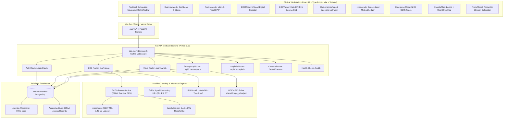

# ❤️ Cardiac Analyst v2.0

> **Academic Research & Educational Prototype for Cardiovascular Risk Stratification, 12-Lead Digital ECG Classification, and Emergency Triage**  
> *A high-performance Progressive Web App (PWA) with deterministic on-device machine learning, explainable ASCVD risk modeling, and zero generative AI in the diagnostic pathway.*

[](https://react.dev)
[](https://www.typescriptlang.org)
[](https://fastapi.tiangolo.com)
[](https://onnxruntime.ai)
[](https://physionet.org/content/ptb-xl/)
[](https://neon.tech)
[](backend/tests/)
[](https://web.dev/progressive-web-apps)
[](LICENSE)

---

> ⚠️ **Regulatory & Medical Notice**:  
> **Cardiac Analyst is an academic research and educational prototype.** It is **not** a certified medical device (CE/FDA/CDSCO) and is **not** intended for independent clinical diagnosis, emergency dispatch, or acute patient management. In any emergency situation or suspected heart attack, immediately call **112** (India), **911** (US), or your local emergency medical response number.

---

## 📑 Table of Contents
1. [The Problem It Is Solving](#-the-problem-it-is-solving)
2. [How It Is Solving It](#-how-it-is-solving-it)
3. [The Proper Tech Stack](#-the-proper-tech-stack)
4. [What Model We Trained and How](#-what-model-we-trained-and-how)
5. [Training & Evaluation Dataset](#-training--evaluation-dataset)
6. [Model Accuracy & Performance Metrics](#-model-accuracy--performance-metrics)
7. [What Is Really Running and How](#-what-is-really-running-and-how)
8. [What Is Running in Fallback Mode](#-what-is-running-in-fallback-mode)
9. [API Keys: Dependencies & Current Configuration](#-api-keys-dependencies--current-configuration)
10. [What Is Working](#-what-is-working)
11. [What Is NOT Working](#-what-is-not-working)
12. [What Still Can Be Improved](#-what-still-can-be-improved)
13. [System Architecture Diagram](#-system-architecture-diagram)
14. [Repository Structure](#-repository-structure)
15. [Quickstart & Local Setup](#-quickstart--local-setup)
16. [Testing & Verification](#-testing--verification)
17. [Authors & Acknowledgments](#-authors--acknowledgments)
18. [License](#-license)

---

## 🫀 The Problem It Is Solving

Cardiovascular disease (CVD) is the leading cause of mortality worldwide, accounting for approximately **17.9 million deaths each year**. In India alone, over **4.77 million lives are lost annually** to acute coronary events.

Critical challenges Cardiac Analyst addresses:
1. **The Pre-Hospital Mortality Window**: Over **60% of acute myocardial infarction (MI) deaths occur before patients reach an emergency room**, driven primarily by delayed symptom recognition and hesitation.
2. **Atypical Symptom Confusion**: Up to 30% of cardiac patients (especially women, diabetics, and the elderly) present without classic crushing substernal chest pain. Instead, they experience atypical symptoms—such as diaphoresis (cold sweats), nausea, jaw ache, or epigastric discomfort—which are frequently dismissed as indigestion or fatigue until cardiac arrest ensues.
3. **Scarcity of Pre-Hospital Electrocardiography**: In rural, peri-urban, and remote regions, access to experienced cardiologists capable of interpreting a 12-lead ECG is severely constrained. Triage nurses and primary care practitioners require instant, dependable second-opinion validation.
4. **The Hazard of Generative AI in Healthcare**: Many consumer health prototypes rely on large language models (LLMs) or multimodal vision APIs (e.g. Gemini Vision or GPT-4o) to diagnose ECG images. These models are inherently probabilistic and suffer from **medical hallucinations**—inventing normal rhythms on ischemic patients or reporting fabricated ST-segment changes. Cardiac Analyst eliminates this hazard by enforcing **zero generative AI in the diagnostic pathway**.

---

## 💡 How It Is Solving It

Cardiac Analyst v2.0 delivers an integrated, deterministic, 3-tier cardiovascular screening and clinical triage workstation:

```
┌────────────────────────────────────────────────────────────────────────┐
│                      DIAGNOSTIC PATHWAY (100% DETERMINISTIC)           │
│                                                                        │
│   Digital ECG ──► SciPy Waveform Signal Processing ──► Heart Rate, QTc │
│   Signal (12L) ──► 1D ResNet (ONNX Runtime CPU) ──► 5 Superclass Scores│
│   Daily Vitals ──► Calibrated LightGBM + TreeSHAP ──► 10-Yr Risk Score │
│   Symptoms ────► NICE CG95 Clinical Decision Rules ──► Triage Urgency  │
└────────────────────────────────────────────────────────────────────────┘
                                     │
                                     ▼
┌────────────────────────────────────────────────────────────────────────┐
│             DUAL-PERSPECTIVE CLINICAL & FAMILY EXPLANATION             │
│                                                                        │
│   Deterministic Dual Analysis Report (Zero LLM Hallucination):         │
│   • Clinical Specialist View: ICD-10 codes, electrophysiology & rhythm │
│   • Family Plain-Language Guide: Everyday analogies, checklist & Qs    │
└────────────────────────────────────────────────────────────────────────┘
```

1. **Tier 1: Routine Screening & 10-Year ASCVD Risk**
   - Patients track daily clinical vitals (systolic/diastolic blood pressure, resting heart rate, SpO2, blood glucose, total cholesterol, HDL, smoking status, diabetes).
   - An ASCVD-calibrated **LightGBM** model predicts 10-year cardiovascular risk tiers (*Low*, *Borderline*, *Elevated*).
   - **TreeSHAP** provides instant, transparent horizontal attribution bars revealing exactly which physiological markers drove the score.
   - Interactive Chart.js charts track 30-day longitudinal blood pressure and vital trends.

2. **Tier 2: Digital 12-Lead ECG Classification**
   - Directly ingests raw digital voltage waveforms (`.csv`, `.npy`, `.json`, WFDB `.hea`/`.dat`).
   - Runs a locally hosted **1D Residual Convolutional Neural Network (ResNet1D)** on **ONNX Runtime CPU** (33.37 MB artifact, **7.46 ms inference latency**).
   - Simultaneously classifies the 5 diagnostic superclasses established by the AHA/ACC and PTB-XL standards:
     - `NORM` (Normal ECG)
     - `MI` (Myocardial Infarction / Acute Ischemic Injury)
     - `STTC` (ST/T-Wave Changes / Subendocardial Ischemia)
     - `CD` (Conduction Disturbance / Bundle Branch Blocks, AV Blocks)
     - `HYP` (Ventricular & Atrial Hypertrophy)
   - Employs **SciPy DSP** to extract objective waveform metrics: Heart Rate, Sinus Rhythm, PR interval, QRS complex duration, and Bazett-corrected QTc ($\text{QTc} = \text{QT} / \sqrt{\text{RR}}$).
   - Enforces **Rule 7 Explicit Failure Handling**: Flatlines, sensor saturation (>100 mV), excessive noise, or missing leads return `status: "analysis_unavailable"` with actionable electrode advice instead of hallucinated clinical output.

3. **Tier 3: Acute Emergency Symptom Triage (NICE CG95)**
   - Evaluates 8 cardinal symptom questions and cardiovascular risk factors based strictly on the UK National Institute for Health and Care Excellence (NICE) Clinical Guideline 95.
   - Evaluated by a single source of truth (`shared/triage_rules.json`) shared across backend Python and frontend TypeScript for 100% online/offline parity across all $2^{12} = 4,096$ possible answer states.
   - Severity tiers: `emergency` (Red), `see_doctor_today` (Amber), and `no_emergency_warning_signs` (Green).
   - Instant direct `tel:112` SOS telephony dialer (bypassing networks/APIs) and interactive Leaflet map locating nearby cardiac emergency rooms and cath labs.

4. **Dual-Perspective Reporting**
   - **Specialist View**: Electrophysiological summary, ICD-10 cross-references, quantitative interval tables, lead-specific ST deviations, and calibrated superclass thresholds.
   - **Family Guide View**: Jargon-free non-physician explanations using clear analogies (e.g. hypertrophy explained as heart muscle thickening from pumping against high resistance), emergency checklists, and targeted questions to ask the attending doctor.

---

## ⚙️ The Proper Tech Stack

### Frontend Client
| Technology | Version | Purpose |
| :--- | :--- | :--- |
| **React** | 19.0+ | Modern component UI rendering with Strict Mode |
| **TypeScript** | 5.8+ | End-to-end type safety, strict null checks, and compile-time verification |
| **Vite** | 6.2+ | Lightning-fast build tooling and development reverse-proxy |
| **Tailwind CSS** | 3.4+ | Production clinical design system with soft ivory tones and 3D layered elevation |
| **Lucide React** | 1.16+ | Crisp, accessible clinical and navigational SVG iconography |
| **Chart.js / react-chartjs-2**| 4.4+ | Interactive longitudinal vitals and blood pressure time-series rendering |
| **Leaflet / react-leaflet** | 1.9+ | OpenStreetMap emergency cardiac hospital visualization |
| **Zustand** | 5.0+ | Lightweight reactive global client state management |
| **PWA (Service Worker)** | — | Offline application caching and emergency directory fallback |

### Backend API & Server
| Technology | Version | Purpose |
| :--- | :--- | :--- |
| **Python** | 3.11.9 | Core backend runtime environment |
| **FastAPI** | 0.115+ | High-performance asynchronous REST API framework |
| **Uvicorn** | 0.34+ | ASGI production server with worker lifecycle management |
| **Pydantic** | v2.10+ | Strict request/response validation contracts and boundary sanitization |
| **SQLAlchemy** | 2.0+ | Relational ORM mapping for users, vitals, analyses, and audit logs |
| **Alembic** | 1.14+ | Transactional database schema migrations (`0001_initial`) |
| **Psycopg2-binary** | 2.9+ | High-throughput PostgreSQL database driver |

### Machine Learning, Signal Processing & Math
| Technology | Purpose |
| :--- | :--- |
| **ONNX Runtime (CPU)** | Low-latency (7.46 ms), thread-safe deep learning inference (`onnxruntime>=1.20.0`) |
| **TensorFlow / Keras 2.x** | Model architecture, GPU training loop, AdamW optimizer, and Cosine Decay schedule |
| **SciPy (`scipy.signal`)** | Deterministic peak detection (`find_peaks`), rhythm classification, and QTc computation |
| **LightGBM** | Gradient-boosted decision trees for routine vitals cardiovascular risk scoring |
| **SHAP (`TreeExplainer`)** | Real-time additive feature attribution explaining risk factors to patients |
| **NumPy & Pandas** | High-performance multidimensional array manipulation and PTB-XL metadata handling |
| **Scikit-Learn** | Stratified fold splitting, AUROC/AUPRC computation, and Platt calibration |

### Security, Cryptography & Database
| Technology | Purpose |
| :--- | :--- |
| **Neon Serverless PostgreSQL**| Managed cloud PostgreSQL with connection pooling (`pool_recycle=300`, `pool_pre_ping=True`)|
| **PyJWT (`HS256`)** | Signed JSON Web Tokens with mandatory $\ge 32$-character cryptographic secret enforcement |
| **Passlib & Bcrypt** | 12-round salted hashing for zero-cleartext password persistence |
| **Sliding Window Rate Limiter**| Persistent database + in-memory protection against credential stuffing and brute-force |
| **Gitleaks** | Automated secret detection in pre-commit hooks and GitHub Actions CI pipelines |

---

## 🧠 What Model We Trained and How

### 1. Model Architecture: Residual 1D CNN (`ResNet1D`)
The model is a custom **1D Residual Convolutional Neural Network** engineered specifically for 12-lead electrocardiography:

```
Input: (Batch Size, 1000, 12) [100 Hz, 10 seconds, 12 Standard Leads]
  │
  ├──► Stem: Conv1D (64 filters, kernel=15, stride=2) + BatchNorm + ReLU + MaxPool1D (size=3, stride=2)
  │
  ├──► Residual Block Stage 1: [Conv1D (64, k=7) -> BN -> ReLU -> Conv1D (64, k=7)] x 2 + Skip
  ├──► Residual Block Stage 2: [Conv1D (128, k=7) -> BN -> ReLU -> Conv1D (128, k=7)] x 2 + Skip
  ├──► Residual Block Stage 3: [Conv1D (256, k=7) -> BN -> ReLU -> Conv1D (256, k=7)] x 2 + Skip
  ├──► Residual Block Stage 4: [Conv1D (512, k=7) -> BN -> ReLU -> Conv1D (512, k=7)] x 2 + Skip
  │
  ├──► GlobalAveragePooling1D
  ├──► Dense (128 units, ReLU) + Dropout (p=0.3)
  └──► Dense (5 units, Sigmoid Activation) ──► Independent Probabilities for [NORM, MI, STTC, CD, HYP]
```

### 2. How We Trained It
- **Hardware**: Dual NVIDIA Tesla T4 GPUs (14.56 GB VRAM) on remote Kaggle cloud infrastructure (`cyberfocus2410/cardiac-analyst-phase-4-full-training`).
- **Optimization**:
  - **Optimizer**: AdamW with weight decay $1 \times 10^{-4}$.
  - **Learning Rate Schedule**: Cosine Decay with an initial learning rate of $1 \times 10^{-3}$, decaying over 25 epochs.
  - **Batch Size**: 64 records per step.
- **Handling Extreme Class Imbalance**:
  - Employs **Weighted Binary Cross-Entropy** with positive class weights computed strictly from training-set inverse class prevalence:
    - `NORM`: 1.25
    - `MI`: 2.90
    - `STTC`: 3.08
    - `CD`: 3.37
    - `HYP`: 5.00
- **Data Augmentation (Training Folds Only)**:
  - Physiological voltage scaling ($0.95 \times$ to $1.05 \times$).
  - Random temporal shift ($\pm 20$ samples / $\pm 0.2$ s).
  - Subtle Gaussian thermal noise ($\sigma = 0.005$).
  - *Validation and test sets remained completely unaugmented and raw.*
- **Early Stopping & Checkpoint Selection**:
  - Monitored **Validation Macro AUROC on Fold 9** (patience = 5).
  - The optimal checkpoint was achieved at **Epoch 14** (`val_macro_auc = 0.9290`), saving `best_model.keras`.
- **Validation Decision Threshold Optimization**:
  - Thresholds $t \in [0.10, 0.90]$ were evaluated on Fold 9 to maximize the F1-score for each respective class.
  - Thresholds were **permanently locked** before touching Fold 10:
    - `NORM`: **0.51**
    - `MI`: **0.41** *(biased toward sensitivity to catch acute infarcts)*
    - `STTC`: **0.70**
    - `CD`: **0.66**
    - `HYP`: **0.75**
- **ONNX Export & Quantization Benchmark**:
  - Converted `best_model.keras` to `model.onnx` (`Float32`).
  - **File Size Reduced**: $100.34\text{ MB} \to \mathbf{33.37\text{ MB}}$ (**66.7% reduction**).
  - **CPU Latency**: $84.42\text{ ms} \to \mathbf{7.46\text{ ms}}$ (**11.3x speedup** on standard CPU).
  - **Numerical Parity**: Maximum absolute difference against Keras: $\mathbf{2.09 \times 10^{-7}}$.

---

## 📊 Training & Evaluation Dataset

The model was developed exclusively on the official **PhysioNet PTB-XL v1.0.3** database:
- **Total Database Records**: 21,799 clinical 12-lead ECGs from 18,885 unique patients.
- **Diagnostic Subset**: 21,388 verified diagnostic records (411 non-diagnostic or corrupted records excluded per PhysioNet benchmark standards).
- **Sampling Rate & Format**: 100 Hz records (1,000 samples $\times$ 12 leads, 10 seconds duration).

### Strict Patient-Level Stratification & Data Hygiene
To prevent data leakage and guarantee real-world generalization, records were partitioned according to the official PhysioNet stratified patient folds:

| Split | Fold Allocation | Records | Unique Patients | Purpose |
| :--- | :--- | :---: | :---: | :--- |
| **Training** | Folds 1–8 | 17,084 | 14,823 | Model parameter optimization and backpropagation |
| **Validation** | Fold 9 | 2,146 | 1,917 | Early stopping and decision threshold tuning |
| **Held-Out Test** | Fold 10 | 2,158 | 1,877 | **Single-pass final benchmark evaluation only** |

> **Zero Patient Leakage**: Confirmed **0 overlapping patient IDs** across Train, Validation, and Test splits. Normalization parameters (per-lead mean and variance) were computed **strictly on Folds 1–8** and saved to `preprocessing_config.json`.

---

## 📈 Model Accuracy & Performance Metrics

The model was evaluated **strictly once** on the 2,158 unseen records of held-out **Fold 10** using the locked thresholds from Fold 9 (`backend/models/EVALUATION_REPORT.md`):

### Macro Performance (with 1,000-Fold Bootstrap 95% Confidence Intervals)
| Metric | Score | 95% Confidence Interval |
| :--- | :---: | :---: |
| **Macro AUROC** | **0.9265** | [0.9194, 0.9330] |
| **Macro AUPRC** | **0.8196** | [0.8038, 0.8351] |
| **Macro F1-Score** | **0.7520** | [0.7350, 0.7658] |
| **Macro Sensitivity (Recall)** | **77.25%** | [0.7546, 0.7891] |
| **Macro Specificity** | **89.85%** | [0.8924, 0.9045] |
| **Macro Precision** | **73.82%** | — |

### Per-Class Test Performance on Held-Out Fold 10
| Superclass | Clinical Description | Locked Thresh | AUROC | AUPRC | Sensitivity | Specificity | F1 Score | Brier Score | Baseline Brier |
| :--- | :--- | :---: | :---: | :---: | :---: | :---: | :---: | :---: | :---: |
| **NORM** | Normal ECG | 0.51 | **0.9447** | 0.9249 | 94.70% | 79.75% | 0.8616 | 0.1054 | 0.2471 |
| **MI** | Myocardial Infarction | 0.41 | **0.9244** | 0.8288 | 80.00% | 87.81% | 0.7420 | 0.0990 | 0.1899 |
| **STTC** | ST/T-Wave Changes | 0.70 | **0.9351** | 0.8314 | 80.04% | 91.63% | 0.7758 | 0.0996 | 0.1832 |
| **CD** | Conduction Disturbance | 0.66 | **0.9259** | 0.8509 | 75.81% | 93.86% | 0.7721 | 0.0901 | 0.1770 |
| **HYP** | Hypertrophy | 0.75 | **0.9021** | 0.6621 | 55.73% | 96.20% | 0.6083 | 0.0847 | 0.1067 |

---

## 🔬 What Is Really Running and How

1. **Local Neural Network Inference**:
   - The ResNet1D model runs locally on the backend CPU using `onnxruntime.InferenceSession`.
   - At server boot, `backend/app/ml/ecg_analyzer.py` loads `model.onnx`, `thresholds.json`, and `preprocessing_config.json` into memory.
   - When a digital ECG file is posted to `/api/v1/ecg/upload`, the signal is normalized via NumPy using pre-computed training statistics, evaluated in $\approx 7\text{ ms}$, and mapped to diagnostic superclasses.
2. **SciPy Electrophysiology Metrics**:
   - `scipy.signal.find_peaks` identifies R-peaks across Lead II to compute real heart rates.
   - PR, QRS, and QT intervals are computed via gradient thresholding. Bazett's correction computes true QTc.
   - ST segments are measured 80 ms after the J-point to flag ST elevation across anterior (`V1`–`V4`), inferior (`II`, `III`, `aVF`), and lateral (`I`, `aVL`, `V5`, `V6`) leads.
3. **High-DPI Canvas 12-Lead ECG Viewer**:
   - `ECGViewer.tsx` draws directly onto an HTML5 `<canvas>` element at 2x device pixel ratio.
   - Renders authentic standard medical pink grid (1 mm minor squares at 4 px, 5 mm major squares at 20 px).
   - Generates 1 mV calibration pulses and offers interactive 3x4 layout, Lead II rhythm strip, lead gain adjustment ($0.5\times, 1.0\times, 2.0\times$), and drag panning.
4. **Authentication & RBAC**:
   - Passwords salted and hashed with 12 rounds of bcrypt.
   - PyJWT generates signed bearer tokens with 24-hour expiration.
   - Self-registration is strictly hardcoded to `role: "patient"`.
   - Clinician access requires explicit patient delegation via invite code or email with anti-enumeration protection.
5. **Database Persistence & Migrations**:
   - Managed Neon Serverless PostgreSQL with 10 tables structured under Alembic (`0001_initial`).
   - Stores raw ECG waveform bytes in PostgreSQL `BYTEA` columns.
   - HIPAA access audit logger records every instance where an authorized clinician views patient data.

---

## 🛡️ What Is Running in Fallback Mode

1. **Offline Hospital Cache (`DEFAULT_OFFLINE_HOSPITALS`)**:
   - If the Google Places API is unreachable, unconfigured, or the user is completely offline, the system falls back to an embedded directory of verified tertiary emergency cardiac centers across Delhi NCR and India (AIIMS, Fortis Escorts Heart Institute, Max Healthcare, Medanta, Apollo, Metro Heart).
   - All emergency hotline links (`112`, `108`, `102`) remain fully operational without internet.
2. **Offline Triage Evaluator (`triageEvaluator.ts`)**:
   - If the FastAPI backend is dormant or experiencing network issues, the frontend runs the identical NICE CG95 triage rules locally in the browser using `shared/triage_rules.json`.
3. **Routine Vitals Model Calibration**:
   - The routine vitals model maps resting blood pressure and vitals into UCI Heart Disease features using clinical heuristics. It is explicitly labeled `"model_status": "experimental, not validated"` in the UI and backend schemas.
4. **Local SQLite Storage**:
   - If `DATABASE_URL` is omitted from the environment, the backend automatically falls back to local SQLite storage (`cardiac_data.db`).

---

## 🔑 API Keys: Dependencies & Current Configuration

| Service / Variable | Required? | Purpose | Current Status |
| :--- | :---: | :--- | :--- |
| `JWT_SECRET_KEY` | **MANDATORY** | Cryptographic key for signing HS256 JWT tokens ($\ge 32$ chars). Server refuses to start without it. | **Configured** (64-character high-entropy secret). |
| `DATABASE_URL` | Optional | Connection string for Neon Serverless PostgreSQL. Defaults to local SQLite if unset. | **Configured** in production/staging environments. |
| `SARVAM_API_KEY` | Optional | Powers secondary patient conversational chat and bilingual summaries. | **Configured** on staging (strictly opt-in; never in diagnostics). |
| `GOOGLE_PLACES_API_KEY` | Optional | Dynamic real-time geolocation query for nearby emergency cardiac hospitals. | **Fallback Mode Active** (Uses cached directory if absent). |

---

## ✅ What Is Working

- **12-Lead Digital ECG Analysis**: Full CSV, JSON, NPY, and WFDB file ingestion with ResNet1D ONNX inference.
- **Deterministic Diagnostic Metrics**: Real Heart Rate, Sinus Rhythm, PR interval, QRS duration, QTc (Bazett), and ST elevation lead localization.
- **Rule 7 Explicit Failure Handling**: Detection and rejection of flatlines, high-frequency sensor noise, voltage clipping (>100 mV), and malformed formats with actionable user messages.
- **Interactive 12-Lead Oscilloscope**: Multi-lead canvas rendering with standard medical grid, calibration pulses, and 3x4 / rhythm strip layouts.
- **Dual Analysis Reporting**: Instant switching between Electrophysiological Specialist view and Family Plain-Language Guide.
- **Routine Screening Mode**: Daily vitals logging, ASCVD risk scoring, and interactive TreeSHAP explainability bars.
- **Emergency Triage Mode**: 8-question NICE CG95 symptom evaluation, one-touch `tel:112` SOS telephony, and live/offline hospital directory.
- **User Authentication & RBAC**: Patient registration, bcrypt login, JWT tokens, patient-clinician access grants, and HIPAA audit logging.
- **Neon PostgreSQL Integration**: Managed relational persistence with transactional Alembic migrations.
- **Automated Verification**: **97/97 backend pytest tests passing** and **100% clean TypeScript/Vite frontend build**.

---

## ⚠️ What Is NOT Working

1. **Scanned Paper / Smartphone Photo ECGs**:
   - Uploading photos (`.png`, `.jpg`) or PDF scans of paper ECGs is **actively rejected**.
   - *Reason*: Paper scans introduce severe perspective tilt, paper creases, lens distortion, and optical noise that lead to fatal misdiagnoses without a dedicated trace-vectorization pipeline. The UI explicitly alerts users to this limitation.
2. **Automated Emergency Dispatch**:
   - Triggering the SOS action does **not** automatically dispatch an ambulance to the user's GPS coordinates.
   - The backend explicitly returns `"emergency_dispatch": false` with a clear disclaimer instructing the patient to speak directly to 112 operators via the device phone dialer.
3. **Self-Service Email Verification & Password Reset**:
   - SMTP-based email verification tokens and forgotten password resets are not yet implemented. Clinician accounts must be provisioned by an administrator.

---

## 🔮 What Still Can Be Improved

1. **Hypertrophy (HYP) Sensitivity**:
   - Current sensitivity on Hypertrophy is 55.73% due to low class prevalence (12.4%) and subtle R-wave voltage criteria. Future iterations can incorporate explicit lead-specific voltage thresholds (Sokolow-Lyon index: $S_{V1} + R_{V5} > 3.5\text{ mV}$, Cornell criteria).
2. **Optical ECG Trace Digitization**:
   - Building a computer vision preprocessing pipeline (perspective correction, pink grid suppression, and U-Net waveform segmentation) to safely extract digital timeseries from paper photos.
3. **Reducing MI False Negatives (20% FNR)**:
   - While Macro AUROC for MI is 0.9244, 110 of 550 MI cases in Fold 10 were missed. Developing an ensemble with 500 Hz high-frequency records will help detect early NSTEMI and subtle T-wave inversions.
4. **Multi-Center Clinical Cohort Validation**:
   - While PTB-XL provides 21,799 European records, validation on diverse cohorts from Indian healthcare institutions (e.g. AIIMS, Fortis) is required to calibrate for demographic variations.
5. **Distributed Redis Rate Limiting**:
   - Upgrading from database-backed rate limiting to a distributed Redis cache for multi-region scale (>5,000 requests/sec).

---

## 🏗️ System Architecture Diagram



---

## 📁 Repository Structure

```
Cardiac_Analyst/
├── backend/
│   ├── alembic/                     # Database migrations
│   │   ├── versions/
│   │   │   └── 0001_initial_schema.py # 10 tables: users, ecg, vitals, audit logs
│   │   └── env.py
│   ├── app/
│   │   ├── auth.py                  # JWT authentication, bcrypt & access verification
│   │   ├── database.py              # PostgreSQL / SQLite connection pooling
│   │   ├── main.py                  # FastAPI factory & CORS middleware
│   │   ├── models_db.py             # SQLAlchemy ORM models
│   │   ├── rate_limiter.py          # Sliding-window IP rate limiter
│   │   ├── schemas.py               # Pydantic v2 validation contracts
│   │   ├── ml/
│   │   │   ├── ecg_analyzer.py      # ECGInferenceService (ONNX Runtime + SciPy DSP)
│   │   │   ├── risk_model.py        # LightGBM ASCVD model with TreeSHAP
│   │   │   ├── sarvam_assistant.py  # Secondary bilingual AI assistant
│   │   │   └── triage.py            # UK NICE CG95 acute coronary triage
│   │   └── routers/
│   │       ├── auth.py              # Register, login, clinician delegation
│   │       ├── chat.py              # Secondary assistant with server consent
│   │       ├── consent.py           # Server-side patient consent management
│   │       ├── ecg.py               # Digital ECG upload, analysis & history
│   │       ├── emergency.py         # NICE CG95 triage & SOS endpoint
│   │       ├── hospitals.py         # Nearby emergency cardiac facilities
│   │       └── vitals.py            # Daily vitals, SHAP & access logs
│   ├── models/                      # Production Model Artifacts
│   │   ├── conversion_benchmark.json# Keras vs ONNX vs TFLite parity audit
│   │   ├── EVALUATION_REPORT.md     # Official PTB-XL Fold 10 benchmark report
│   │   ├── fold10_test_results.json # Full held-out evaluation metrics
│   │   ├── label_mapping.json       # NORM, MI, STTC, CD, HYP mapping
│   │   ├── MODEL_CARD.md            # Clinical AI model card
│   │   ├── model.onnx               # 33.37 MB 1D ResNet model
│   │   ├── preprocessing_config.json# Training-set normalization parameters
│   │   ├── thresholds.json          # Locked validation decision thresholds
│   │   └── samples/                 # Real PTB-XL Fold 10 CSV samples
│   ├── tests/                       # 97 Automated Pytest Verification Suites
│   │   ├── test_access_audit_log.py
│   │   ├── test_admin_bootstrap_cli.py
│   │   ├── test_auth_access_control.py
│   │   ├── test_client_ip_and_rate_limits.py
│   │   ├── test_clinician_grants_by_email.py
│   │   ├── test_database_and_migrations.py
│   │   ├── test_ecg_pipeline.py
│   │   ├── test_emergency_path.py
│   │   ├── test_emergency_public_access.py
│   │   ├── test_input_validation.py
│   │   ├── test_jwt_secret_enforcement.py
│   │   ├── test_login_protection.py
│   │   ├── test_role_hardening.py
│   │   ├── test_route_security_audit.py
│   │   ├── test_server_side_consent.py
│   │   ├── test_strict_health_data_auth.py
│   │   ├── test_third_party_data_flow.py
│   │   └── test_triage_exhaustive_safety.py
│   ├── bootstrap_admin.py           # Independent admin bootstrap CLI tool
│   ├── requirements.txt             # Backend Python dependencies
│   ├── start.bat                    # One-click Windows launch script
│   └── test_local_ecg.py            # Standalone ONNX runtime test
├── docs/                            # Centralized Engineering & Clinical Documentation
│   ├── architecture/                # Architecture audit and production readiness checklist
│   ├── clinical/                    # Clinician sign-off document for triage rules
│   ├── history/                     # Chronological development record
│   ├── specifications/              # PRD / FRD specifications (v2)
│   └── workflows/                   # Kaggle training and conversion workflows
├── notebooks/                       # Interactive Data Science & ML Notebooks
│   └── cardiac_analyst_ptbxl_training.ipynb
├── ml_training/                     # PTB-XL GPU Training Pipeline
│   ├── config.py                    # Hyperparameters, split folds, lead definitions
│   ├── data_loader.py               # PhysioNet PTB-XL multi-label loader
│   ├── evaluate.py                  # Single-pass held-out test evaluation routine
│   ├── model.py                     # ResNet1D PyTorch / Keras architectures
│   ├── preprocess.py                # Per-lead normalization & filter logic
│   ├── train.py                     # Training loop with early stopping
│   ├── kaggle_convert/              # ONNX conversion scripts
│   ├── kaggle_eval/                 # Held-out Fold 10 benchmark evaluation
│   ├── kaggle_smoke/                # Rapid verification smoke tests
│   └── kaggle_train/                # Kaggle remote training scripts
├── public/
│   ├── samples/                     # Real PTB-XL benchmark samples for quick trials
│   ├── manifest.json                # PWA web application manifest
│   └── sw.js                        # Offline service worker cache
├── shared/
│   └── triage_rules.json            # Clinical single source of truth for triage
├── src/
│   ├── components/
│   │   ├── AppShell.tsx             # Responsive workstation frame
│   │   ├── DualAnalysisReport.tsx   # Dual clinical & family reporting
│   │   ├── ECGViewer.tsx            # High-DPI canvas pink grid ECG viewer
│   │   ├── HospitalMap.tsx          # MapLibre GL JS & OpenFreeMap vector map
│   │   ├── ProfileModal.tsx         # Account authentication & demographics
│   │   ├── RiskArc.tsx              # Calibrated ASCVD risk gauge
│   │   ├── Sidebar.tsx              # Navigation rail with active pills
│   │   └── TopBar.tsx               # Status header with 112 SOS telephony
│   ├── data/
│   │   └── evaluation_metrics.json  # Synced Fold 10 benchmark metrics
│   ├── lib/
│   │   ├── api.ts                   # Central typed API client
│   │   ├── translations.ts          # English & Hindi clinical translations
│   │   └── triageEvaluator.ts       # Shared triage evaluation engine
│   ├── modes/
│   │   ├── ECGMode.tsx              # 12-lead digital ECG analysis suite
│   │   ├── EmergencyMode.tsx        # NICE CG95 triage & hospital routing
│   │   ├── HistoryMode.tsx          # Searchable patient ledger
│   │   ├── OverviewMode.tsx         # Clinical dashboard & model status
│   │   └── RoutineMode.tsx          # Vitals tracking & TreeSHAP
│   ├── store/
│   │   └── useStore.ts              # Zustand state store
│   ├── App.tsx                      # Root application component
│   └── main.tsx                     # React 19 entry point
├── LICENSE                          # MIT License with Clinical Terms of Use
├── PRIVACY.md                       # Comprehensive privacy policy & zero-PII guarantees
├── TERMS.md                         # Terms of service and liability limitations
├── package.json                     # Frontend dependencies
├── tailwind.config.js               # Clinical palette & styling config
└── vite.config.ts                   # Reverse proxy configuration
```

---

## 🛠️ Quickstart & Local Setup

### Prerequisites
- **Node.js** $\ge 18.0$ and **npm** $\ge 9.0$
- **Python** $\ge 3.10$ (Python 3.11 recommended)
- **Git**

---

### Step 1: Clone Repository
```bash
git clone https://github.com/Adhya08/Cardiac_Analyst.git
cd Cardiac_Analyst
```

---

### Step 2: Backend Setup

#### Option A: Windows One-Click Launch
Double-click `backend/start.bat` or execute in PowerShell:
```cmd
cd backend
start.bat
```
*(Automatically creates `venv`, installs requirements, checks model artifacts, and launches FastAPI on `http://localhost:8000`.)*

#### Option B: Manual Setup (Windows / macOS / Linux)
```bash
cd backend

# Create and activate virtual environment
python -m venv venv

# Windows:
venv\Scripts\activate
# macOS/Linux:
source venv/bin/activate

# Install dependencies
pip install --upgrade pip
pip install -r requirements.txt

# Create .env file with mandatory JWT Secret:
echo "JWT_SECRET_KEY=cardiac-analyst-secure-production-jwt-key-32chars" > .env

# Optional: Run database migrations (or defaults to SQLite)
# alembic upgrade head

# Launch FastAPI development server
python -m uvicorn app.main:app --reload --host 0.0.0.0 --port 8000
```
Open `http://localhost:8000/docs` in your browser to inspect interactive Swagger documentation.

---

### Step 3: Frontend Setup

Open a new terminal in the project root:
```bash
# Install frontend dependencies
npm install

# Start Vite development server
npm run dev
```
Open `http://localhost:5173` in your browser. Vite automatically proxies `/api/*` requests to `http://localhost:8000`.

---

## 🧪 Testing & Verification

### 1. Run Complete Backend Pytest Suite (97 Tests)
```bash
cd backend
pytest tests/ -v
```
*Validates 100% test passing across 18 specialized suites: strict authentication, brute-force lockout, rate limiting, patient-clinician grants, access audit logs, database migrations, 4,096 triage combinations, and ResNet1D inference.*

### 2. Standalone Local ONNX Verification
```bash
python backend/test_local_ecg.py
```
*Loads `backend/models/model.onnx`, executes inference across all 5 PTB-XL Fold 10 sample signals, and verifies Rule 7 failure handling.*

### 3. Exhaustive 4,096 Triage Safety Parity Check
```bash
node scripts/exhaustive_triage_runner.js
```
*Asserts 100% mathematical parity between frontend TypeScript and backend Python for every possible combination of symptom answers.*

### 4. Production Frontend Build
```bash
npm run build
```
*Compiles TypeScript and bundles production assets into `dist/` with 0 errors.*

---

## 👥 Authors & Acknowledgments

- **Adhya Kulshreshtha** ([@Adhya08](https://github.com/Adhya08)) — Project Lead, Machine Learning Architecture, PTB-XL ResNet1D Training, Clinical Workstation Design & Systems Integration
- **Vivan Mittal** ([@CyberFocus2410](https://github.com/CyberFocus2410)) — Collaborator, Deployment Infrastructure & Automated Verification

---

## 📄 License

This repository is distributed under the terms of the [MIT License](LICENSE) with mandatory **Clinical & Medical Device Terms of Use**.  
*(Note: Academic datasets from PhysioNet PTB-XL and the UCI Machine Learning Repository are subject to their respective institutional licenses.)*
